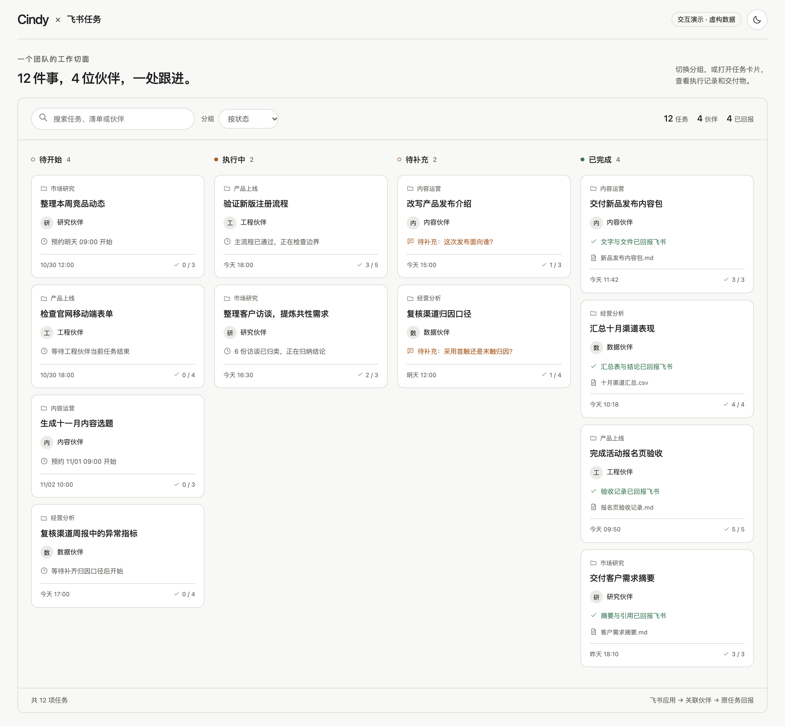

# 飞书任务 · Cindy 插件

将飞书应用关联到 Cindy 伙伴。飞书向应用指派任务后，插件交给对应伙伴执行，并回报进度、结果与产物。

本仓库独立维护源码、测试和 `.cindy` 安装包，无需把飞书业务代码放入 Cindy 主仓库。

## 看看它如何协作

[介绍与交互演示](docs/demo/feishu-task.html)：下载这一份 HTML 即可离线打开。12 项虚构任务、4 位伙伴，支持按状态、清单、伙伴和创建人分组，点击任务查看执行记录、预览和下载演示文件。



[任务详情与回报截图](docs/demo/task-result.png)。演示页面不连接飞书，不代表实际线上验收结果。运行 `node scripts/capture-demo.cjs` 可重现截图并检查交互。

## 当前发行

**0.15.5 仅交付开发源码，完整兼容安装包尚不可提供。**

新增 inspect_host_support，只读检查当前适配器需要的入口，不读取凭据、不发送任务。Node 仅在授权或上传请求捕获测试扩展，普通飞书请求和身份恢复不再无条件捕获。

正式 0.1.120 已核实两个关键缺口：Node 动态鉴权与 Host 文件过户上传的组合，以及关联伙伴的范围受限执行和可信 settled 回执。插件自管安全凭据仍未实现；不能声称该部分天然要求修改 Core。见 [证据与验证范围](docs/compatibility.md) 及 [最小公开协议方案](docs/minimal-host-contract.md)。

删除 minCindyVersion 导致的 MANIFEST_INVALID 是清单校验失败，不是运行时缺能力的证据。该字段代表完整插件实际功能依赖的正式版本；只读检查通过不能据此填写 0.1.120。当前没有可真实填写的完整兼容版本，不以伪造字段或另造诊断插件替代目标。历史 Releases 仅为测试构建预览。

## 目标功能（完整流程待验收）

- 在应用设置扫码或打开授权链接，创建或选择飞书应用，关联处理伙伴。最多四个独立应用连接。
- 接收飞书任务，按状态、清单、伙伴或创建人分组查看；详情展示描述、日期、直接子任务、附件和进度。
- 插件自行按预约和重试时间唤醒队列，无需等待页面操作或连接心跳。伙伴忙时每分钟检查原伙伴，暂停接收即停止唤醒。
- 有开始日期时预约执行；循环任务无开始日期时使用截止日期。清单分组保留在插件内。
- 固定伙伴处理任务，完成后回报原飞书任务；产物支持打开和下载。
- 按应用隔离凭据和记录，保留原任务伙伴映射及未知投递状态，避免盲目重复执行。

## 开发与测试

需要 Node.js 22 和 npm。

```sh
npm ci
npm run build
npm test
# 只读核验本机正式安装产物（非真实闭环）：
npm run audit:host
npx playwright install chrome
npm run test:ui
```

UI 测试使用模拟 Host，覆盖明暗模式及 320–1360px；通过不代表飞书线上闭环通过。真实循环任务的两期自然执行仍待验收，跨设备授权及长期断线补收也未完成端到端验收。

## 打包与发布

当前源码清单仍未达到发行条件；以下流程待实际功能依赖的正式版本确定后执行。没有本阶段安装包或安装包校验值。

在 Cindy 中使用插件创作工具 `ghost_forge_pack`，将 `dir` 指向本仓库 `plugin/` 的绝对路径。工具校验后生成 `feishu-task-bridge-<version>.cindy`。安装包通过 GitHub Releases 独立发布；Cindy 市场提审另走已安装实例的发布预检和审核流程。

后续更新通过分支、测试和 PR 合并到最新 `main`，再发布与提交一致的安装包。发布步骤见 [发布说明](docs/releasing.md)。

## 目录

- `src/`：插件后台、任务队列、认证与飞书协议。
- `plugin/`：清单、页面、图标与构建产物。
- `test/`、`scripts/`：自动测试和构建。
- `docs/`：兼容性与发布流程。

公开仓库不包含真实任务记录、账号凭据、人员信息或私人验收截图。随包依赖的许可见 [第三方声明](plugin/THIRD_PARTY_NOTICES.md)。
