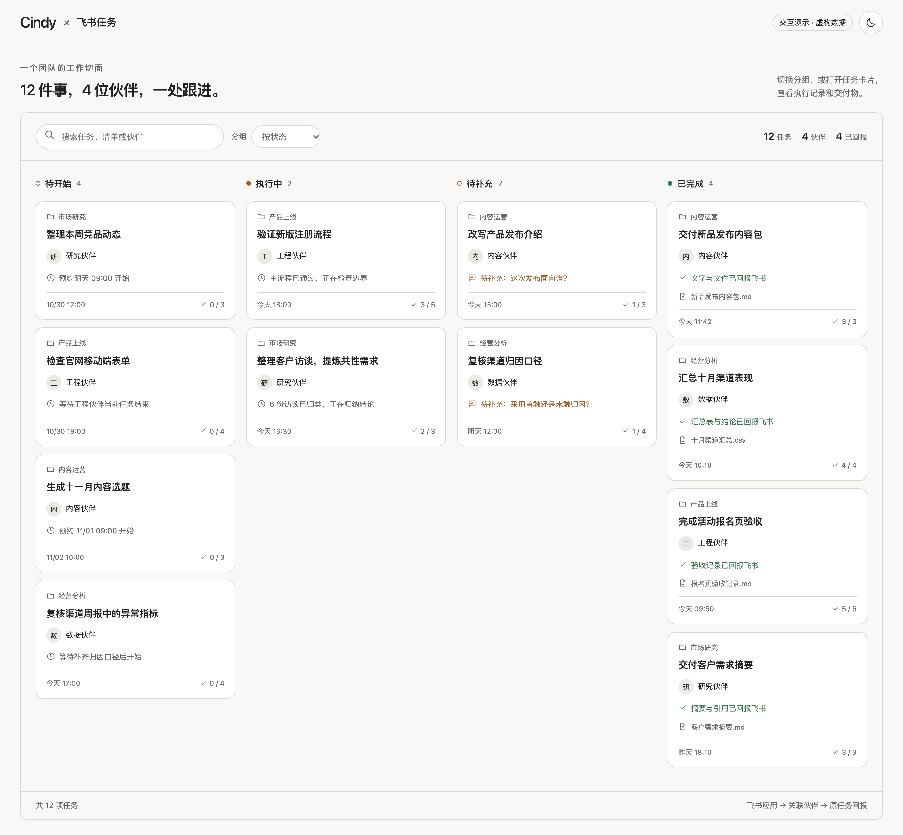

# 飞书任务 · Cindy 插件

将飞书应用关联到 Cindy 伙伴。飞书向应用指派任务后，插件交给对应伙伴执行，并回报进度、结果与产物。

本仓库独立维护源码、测试和 `.cindy` 安装包，无需把飞书业务代码放入 Cindy 主仓库。

## 看看它如何协作

[介绍与交互演示](docs/demo/feishu-task.html)：下载这一份 HTML 即可离线打开。12 项虚构任务、4 位伙伴，支持按状态、清单、伙伴和创建人分组，点击任务查看执行记录、预览和下载演示文件。



[任务详情与回报截图](docs/demo/task-result.png)。演示页面不连接飞书，不代表实际线上验收结果。运行 `node scripts/capture-demo.cjs` 可重现截图并检查交互。

## 当前发行

**0.15.13 发行包已准备；最低客户端版本 Cindy 0.1.124，仅支持 macOS。** 最低版本由正式源码接口确认，真实完整闭环已在当前安装的 0.1.130 构建通过：伙伴执行、进度和文字回报、Host 票据文件上传、飞书完成状态独立读回、附件下载逐字节一致及测试清理。0.1.124 尚未单独实测。

当前安装构建记录的 sourceCommit 与官方 v0.1.130 tag 不同，不能把此次结果推广为所有同版本发行二进制均已验收。具体来源、版本边界和未覆盖场景见 [兼容性与验收范围](docs/compatibility.md)。

设置页通过飞书 SDK 扫码连接；凭据由插件自管 macOS 钥匙串保存。最多四个独立应用连接，支持恢复、取消扫码和解除绑定。业务代码无需进入 Cindy 主仓库。退出 Cindy 后不会继续执行。

专用连接测试分段计时：创建与事件 10 分钟、受理排队 30 分钟、实际开工后 10 分钟。普通任务接收遵循用户保存的选择。

0.15.15 补齐飞书原生“立即执行”的 `task_agent_start` 事件接入；仅响应开启接收后的实时开工请求，并核对当前唯一应用执行人及未开始状态。普通任务保留在任务清单，不走专用连接测试的自动清理；“全部状态”同时显示已停止任务。本轮用户界面创建的普通任务已受理并交给伙伴，但开工回写返回 `FEISHU_API_1470400`，因此尚未验收普通任务的完整回报闭环。

0.15.17 修复重启接收恢复：恢复原接收基线，启动暂时失败最多尝试三次，展示持续恢复错误；并发开启去重，暂停取消在途启动。受控智能体任务保存飞书原生开工事件的 `execution_id`，用于进度、结果、评论、步骤和文件上传；Cindy 执行回执 ID 不作替代。最终进度使用简短状态，完整结论保留在结果正文。已结算但回写受阻的执行不会继续占用伙伴，待核实账本保留，不重发未知写入。

本轮已在当前正式客户端 0.1.133 原位更新验证插件运行时重启自动恢复接收，并完成一条真实用户创建的原生任务：伙伴查询、开工、文字结果、完成状态独立读回通过；任务保留。业务口径待确认的信息由原伙伴明确写在结果中，没有伪造精确结论。未为了验收重启仍有其他伙伴工作的整个客户端。

## 功能与验证范围

- 在应用设置扫码或打开授权链接，创建或选择飞书应用，关联处理伙伴。最多四个独立应用连接。
- 接收飞书任务，按状态、清单、伙伴或创建人分组查看；详情展示描述、日期、直接子任务、附件和进度。
- 插件自行按预约和重试时间唤醒队列，无需等待页面操作或连接心跳。伙伴忙时每分钟检查原伙伴，暂停接收即停止唤醒。
- 有开始日期时预约执行；循环任务无开始日期时使用截止日期。清单分组保留在插件内。
- 固定伙伴处理任务，完成后回报原飞书任务；产物支持打开和下载。
- 按应用隔离凭据和记录，保留原任务伙伴映射及未知投递状态，避免盲目重复执行。

## 开发与测试

需要 Node.js 22 和 npm。

```sh
npm ci
npm run build
npm test
# 只读核验本机正式安装产物（非真实闭环）：
npm run audit:host
npx playwright install chrome
npm run test:ui
```

UI 测试使用模拟 Host，覆盖明暗模式及 320–1360px；通过不代表飞书线上闭环通过。真实循环任务的两期自然执行仍待验收，跨设备授权及长期断线补收也未完成端到端验收。

## 打包与发布

源码清单已补齐真实的 `minCindyVersion=0.1.124`。发行包与已验业务构建保持一致，只更新兼容元数据及文档。准备包不等于 GitHub Release 发布或市场上架。

在 Cindy 中使用插件创作工具 `ghost_forge_pack`，将 `dir` 指向本仓库 `plugin/` 的绝对路径。工具校验后生成 `feishu-task-bridge-<version>.cindy`。安装包通过 GitHub Releases 独立发布；Cindy 市场提审另走已安装实例的发布预检和审核流程。

后续更新通过分支、测试和 PR 合并到最新 `main`，再发布与提交一致的安装包。发布步骤见 [发布说明](docs/releasing.md)。

## 目录

- `src/`：插件后台、任务队列、认证与飞书协议。
- `plugin/`：清单、页面、图标与构建产物。
- `test/`、`scripts/`：自动测试和构建。
- `docs/`：兼容性与发布流程。

公开仓库不包含真实任务记录、账号凭据、人员信息或私人验收截图。随包依赖的许可见 [第三方声明](plugin/THIRD_PARTY_NOTICES.md)。
